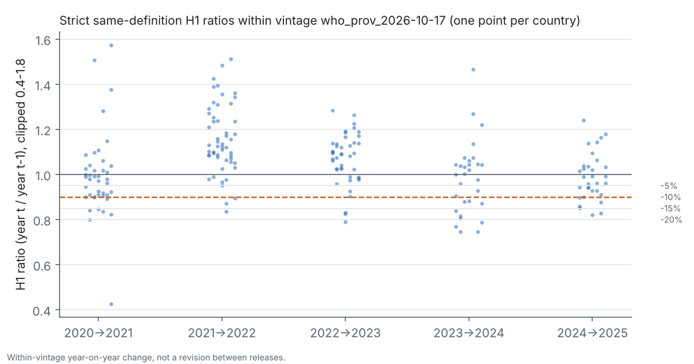

# Are TB notification decline alerts stable across WHO public data vintages?

Investigator: Isaac Omoding · Research programme R02 · Stage: **checkpoint 1 (cloud), decision HOLD_ACCESS**

WHO publishes provisional monthly and quarterly TB notifications so that falls in case finding can be
spotted quickly. These files are revised as countries update them. If a programme or funder reads
"notifications fell by at least 10% in the first half-year" from one release, how often would a later
release reverse that reading, and would a simple precommitted "verify before acting" rule be worth its
cost? Notifications are not incidence, and nothing here attributes changes to any cause.

## Research questions

1. After matching period, reporting frequency and coverage definition, how often do first-half (H1)
   year-on-year decline alerts at 5/10/15/20% change between WHO provisional vintages?
2. How large are continuous revisions to H1 ratios, and how do they depend on maturity and country?
3. Does a predeclared defer/verify rule (defer when the early ratio is within 0.03 of the 10% cut-off)
   reduce reversals at an acceptable deferral cost, judged on an uninspected later vintage?

## What is known and what is not claimed

WHO states that these data are provisional (Global TB Reports 2021–2022; Falzon et al., *Front Immunol*
2023, doi:10.3389/fimmu.2023.1234785), and reporting-delay nowcasting is well developed
(Höhle & an der Heiden, *Biometrics* 2014, doi:10.1111/biom.12194). This project would add a
*decision-level* measure: how often alerts reverse across public releases. See
[docs/PRIOR_ART.md](docs/PRIOR_ART.md). An earlier exploratory analysis reported 5 of 108 alerts
changed at the 10% threshold; **that result has not been reproduced here.**

## Data and current access

| Source | Coverage | Status |
|---|---|---|
| WHO `provisional_notifications` CSV, vintage 2026-10-17 (56,347 B, SHA-256 `a4be40a0…84aa8630d29e4c52afb35e6735a8b312032d4fb8cd684b`) | 142 countries, 2020–2026, 647 country-years | fetched, hash-verified |
| WHO TB data dictionary | code definitions | fetched |
| Archived earlier vintages (Internet Archive) | — | **blocked** by this cloud environment's network policy |

Every attempt, including failures, is in [data/manifest/source_attempts.csv](data/manifest/source_attempts.csv).

## Checkpoint-1 results (one vintage; descriptive only)


* Complete H1 data: 117 countries for 2021, 67 for 2025, and **0 for 2026** (only January, 7
  countries, 109 days after H1 ended).
* Same-definition (strict) year pairs: 200 from 76 countries; 2021–2025 balanced panel: 10 countries.
* Strict pairs with an H1 decline of 10% or more within this vintage: 31/200 = 15.5% (country-cluster
  bootstrap 95% CI 11.2–20.2%). This is year-on-year change, **not** revision reliability.
* Cross-vintage reversals and the defer rule: **not computable** with one vintage.



Full numbers: [docs/STATUS.md](docs/STATUS.md) · tables: [results/](results/README.md).

## Design

Raw WHO file → H1 totals (six months or two quarters, never partial) → strict / relaxed same-definition
pairs → threshold alerts → cross-vintage comparison against a later file (a reference, not the truth)
→ predeclared defer rule evaluated on a cost-ratio grid → country-cluster bootstrap. No reporting
triangle is built from a single file, and no ML is fitted. Protocol (frozen before any second vintage):
[docs/SCIENTIFIC_PROTOCOL.md](docs/SCIENTIFIC_PROTOCOL.md).

## Reproduce

```bash
python3 -m venv .venv && .venv/bin/pip install -e ".[test,dashboard]"
python scripts/acquire.py            # one request; a new date is a new vintage
python scripts/run_pipeline.py       # needs the hash-matching raw file(s) in configs/experiment.yaml
pytest -q                            # synthetic fixtures + committed aggregates
streamlit run dashboard/app.py       # local aggregate explorer, not deployed
```

Details: [docs/REPRODUCIBILITY.md](docs/REPRODUCIBILITY.md).

## Risks and next step

The main risk is access: without earlier vintages, the core question cannot be answered. The next step
is to obtain one or more lawful earlier vintages (archived files with capture timestamps) or to download
the next WHO release and run the predeclared prospective test. Thinning coverage and slow maturity may
also limit any "early warning" use. See [docs/LIMITATIONS.md](docs/LIMITATIONS.md) and
[docs/DECISION_LOG.md](docs/DECISION_LOG.md).

## Acknowledgements and disclosure

Data: WHO Global Tuberculosis Programme. Code, analysis and documentation in this checkpoint were
produced with AI assistance (Claude Code) under the investigator's direction and need human review.
Operating contract: [AGENTS.md](AGENTS.md).
