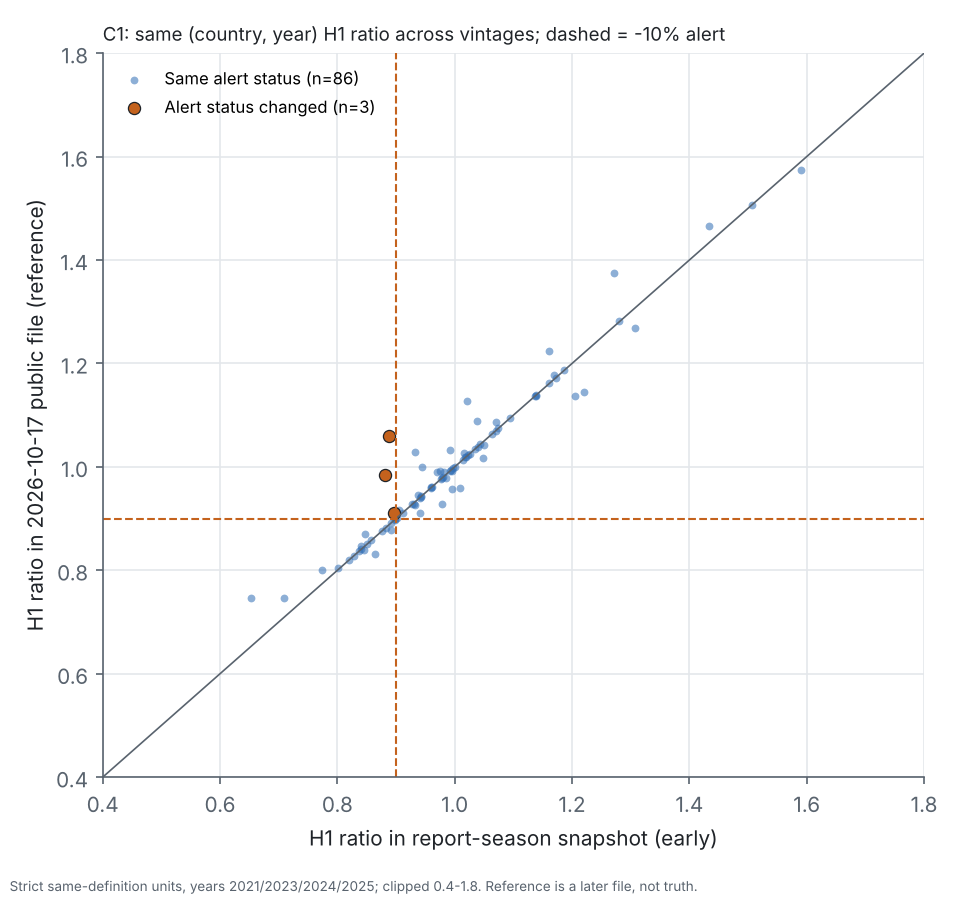
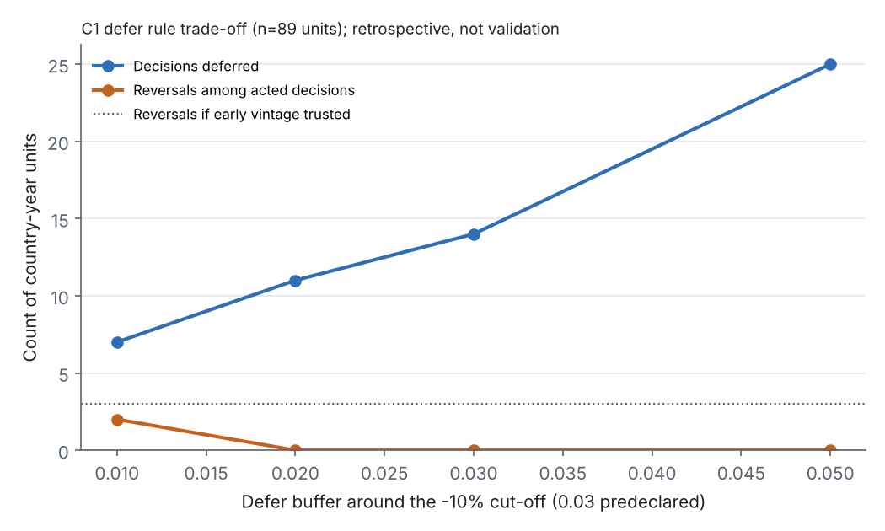
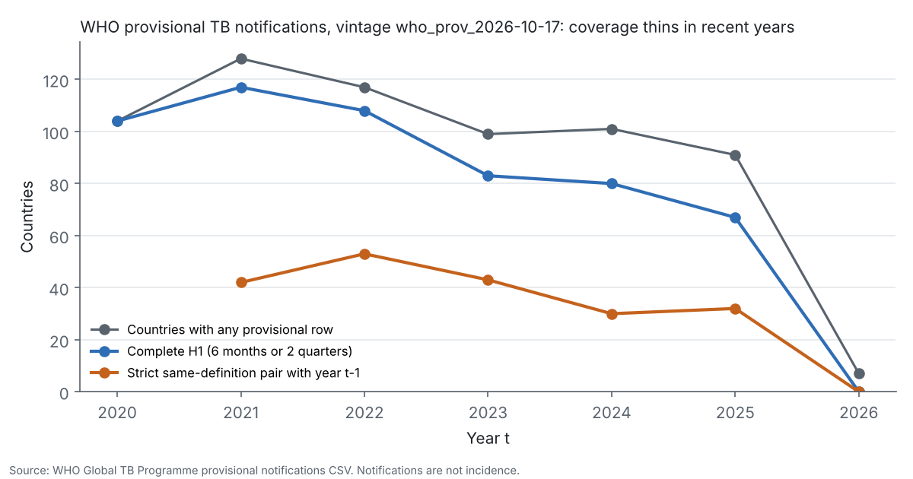

# Are TB notification decline alerts stable across WHO public data vintages?

Investigator: Isaac Omoding · Research programme R02 · **Decision: RESERVE (methods-note candidate)** ·
Retrospective, exploratory analysis. Not a WHO product.

## Question and gap

WHO publishes **provisional** monthly and quarterly TB notifications and revises them. A programme or
funder might read "first-half (H1) notifications fell by at least 10%" from one release. This project
asks two things:
1. After matching period, reporting frequency and coverage definition, how often does a later release
   reverse that alert?
2. Would a simple predeclared *verify-before-acting* (defer) rule have paid off?

It is known that these data are provisional and that reporting delays exist. The gap addressed here is
**decision-level**: how often operational threshold alerts actually reverse across public releases.

**Notifications are not incidence.** Nothing here estimates disease burden, attributes changes to causes
or forecasts anything, and no ML was used.

**Prior art read.** This is a bounded audit; depth labels are in [docs/PRIOR_ART.md](docs/PRIOR_ART.md).
- WHO Global TB Reports 2021–2022 on provisional data: catalogue level.
- Falzon et al., *Front Immunol* 2023, doi:10.3389/fimmu.2023.1234785: abstract.
- Höhle & an der Heiden, *Biometrics* 2014, doi:10.1111/biom.12194 (reporting-delay nowcasting): abstract.
- WHO GTB-TME report repositories: file listings only.

No full texts were reviewed, so novelty claims stay modest.

## Data

| Source | Years in data | Vintages | Status |
|---|---|---|---|
| WHO public provisional notifications CSV, accessed 2026-10-17 (SHA-256 `a4be40a0…35e6735a8b312032d4fb8cd684b`) | 2020–2026 (142 countries) | 1 (reference) | fetched, hash-verified |
| WHO Global TB Programme report repositories `GTB-TME/gtbreport2021`–`2025` (internal `monthly` snapshots) | 2020–2025 | 15 distinct (17 files; 2 duplicates). Nominal dates 2021-06-29 to 2025-07-30 | fetched by git, hash-verified ([manifest](data/manifest/gtb_tme_snapshots.csv)) |
| Internet Archive copies | — | — | blocked in this environment; not needed |

**Dates.**
- *Nominal snapshot dates* are WHO's internal extraction dates, taken from file names.
- *Public-by* dates are git committer dates. These are asserted by the committer's client, so they are
  **not proven publication times**. They fall 105, 130, 121 and 135 days after H1 ended for the
  2021/2023/2024/2025 report snapshots.
- The 2022 repository has a single commit, dated 2025.

**Acquisition log.** Every attempt, including failures and blocked hosts, is in
[source_attempts.csv](data/manifest/source_attempts.csv).

**Licensing.** The public CSV falls under WHO's data-policy terms. Reuse terms for the GitHub snapshots
are unconfirmed, so the public dashboard withholds archive-derived results:
[docs/DEPLOYMENT.md](docs/DEPLOYMENT.md).

## Definitions, preprocessing and matched design

**Preprocessing.**
- Internal snapshots are mapped to the public schema (`report.frequency` → `report_frequency`).
- The free-text `remarks` field, which can name individuals, and the undocumented `gaps.na` field are
  dropped at load.
- Placeholder rows with all 16 count cells missing are dropped and counted.

**Variables and units.**
- **H1 total:** the sum of January–June (monthly reporters) or of Q1+Q2 (quarterly reporters). Every
  cell must be present; partial sums are never used.
- **Unit:** one country's ratio r = H1(t) / H1(t−1).
- **Strict tier** (primary):
  - same reporting frequency in both years;
  - all-units coverage (code 34) in both years;
  - no zero H1 cell;
  - H1(t−1) of at least 50.
- **Relaxed tier** (sensitivity): same frequency and the same coverage code, with any non-zero base.
- **Decline alert at k:** r ≤ 1 − k, for k = 5, **10** (primary), 15 and 20%.

**Matched cross-vintage design (C1, primary).**
- The **early** vintage for year t is WHO's report-season snapshot for that year.
- The **reference** is the 2026-10-17 public file. It is a later provisional file, **not truth**.
- A unit is compared only if it is strict in both files **and** its frequency and coverage metadata are
  identical across the two releases.
- Every unit's join or exclusion status is audited in
  [cross_vintage_exclusions.csv](results/tables/cross_vintage_exclusions.csv).
- The design was frozen before computation (commit `8a1bd25`; see
  [protocol, Addendum A](docs/SCIENTIFIC_PROTOCOL.md)).

**Cohort flow (C1, strict).** Counts are for 2021 / 2023 / 2024 / 2025.

| Status | 2021 | 2023 | 2024 | 2025 |
|---|---|---|---|---|
| Included | 26 | 15 | 18 | 30 |
| Not yet complete in the early snapshot | 14 | 25 | 11 | 2 |
| Absent from the early snapshot | 2 | 2 | 0 | 0 |
| Coverage code changed in the early snapshot | 0 | 1 | 1 | 0 |

No strict early unit was lost or changed metadata in the reference.

**Defer rule.**
- *The rule:* defer (verify or wait) when |r_early − 0.90| < **0.03**; otherwise act on the early file.
- *Reporting:* trade-offs across buffers {0.01, 0.02, 0.03, 0.05} and deferral-to-error cost ratios
  {0.05 … 1.0}.
- *Caveat:* the 0.03 buffer was **inherited from earlier exploratory work on overlapping data**. It was
  fixed in advance here but **not independently validated**.

**Uncertainty.**
- The independent unit is the **country**, with up to 4 country-years each.
- Confidence intervals use a country-cluster percentile bootstrap: 2,000 resamples of whole countries,
  seed 20261017.

## Results (retrospective)

| C1 primary (strict, identical metadata) | Value |
|---|---|
| Country-years / independent countries | **89 / 52** |
| Alerts changed at 5 / 10 / 15 / 20% | 5 / **3** / 2 / 1 |
| Stable at 10% | **86** |
| Share changed at 10% (95% CI) | **3.4% (0–7.6%)**. All 3 were false early alarms; no early misses |
| Relaxed tier | 8 / 125 changed at 10% (6.4%, CI 2.4–11.8%) |
| `h1_equivalent` metadata rule | identical to the primary (no metadata switches) |
| Defer rule (0.03 at 10%) | defers **14**, avoids **3**. Break-even deferral/error cost ratio 0.21, **retrospectively only** |





**Maturity.**
- A year's values are revised until the next year's report snapshot, then barely change.
- Coverage in the current public file is thinning: 117 countries had complete H1 in 2021, 67 in 2025,
  and none for 2026 at 109 days after H1 ended.



Full numbers: [docs/STATUS.md](docs/STATUS.md) · tables: [results/](results/README.md).

## Results explorer

`streamlit run dashboard/app.py` opens a local, read-only explorer of the committed aggregates. It has
filters for analysis, tier, metadata rule, sample, threshold, year and country, plus clustered-CI
comparisons, the defer-rule trade-offs, and allowlisted downloads.

- **Default scope:** shows only results derived from the public CSV.
- **Full scope:** set `R02_SHOW_ARCHIVE_DERIVED=1` to add the archive-derived results, for local
  research use only until licensing is confirmed.

It is **not deployed**. See [docs/DEPLOYMENT.md](docs/DEPLOYMENT.md).

## Reproduce

The full outputs were re-run once from the 16 hash-verified cached inputs on 17 October 2026. All 13
tables and 5 figures came out byte-identical. Commands and evidence:
[docs/REPRODUCIBILITY.md](docs/REPRODUCIBILITY.md).

```bash
python3 -m venv .venv && .venv/bin/pip install -e ".[test,dashboard,archives]"
OMP_NUM_THREADS=1 .venv/bin/python scripts/run_pipeline.py    # needs raw files matching configs/experiment.yaml
.venv/bin/python scripts/make_results_manifest.py --check
.venv/bin/python -m pytest -q                                # 29 tests; no network, no model training
```

## Limits and next step

- **Not independent.** This is retrospective, and the archives overlap earlier exploratory work.
- **Few events.** The confidence interval reaches 0, and the balanced panel has only 4 countries.
- **Uncertain dates.** Public-by dates are not WHO release dates.
- **Unmeasured costs.** Decision costs are not measured.
- **Reference not reproducible.** The 2026-10-17 public CSV cannot be re-downloaded.

The only independent test is prospective: apply the frozen rule unchanged to the next WHO report
snapshot. See [docs/LIMITATIONS.md](docs/LIMITATIONS.md).

## Attribution and disclosure

**Data:** World Health Organization, Global Tuberculosis Programme. Provisional TB notifications
(accessed 2026-10-17) and the WHO GTB-TME Global TB Report repositories. The underlying data are
reported to WHO by countries and territories.

**Analysis:** the analysis, code and figures were created by the investigator. They are not a WHO
product, and WHO does not endorse them. They were produced with AI assistance (Claude Code) under the
investigator's direction and need human review.

Operating contract: [AGENTS.md](AGENTS.md).
